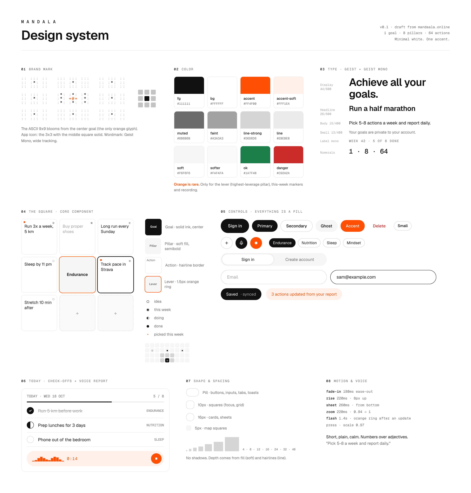

# Mandala design system

The look of the app in one place. It describes what the app already does; the code in
`src/app/globals.css` and `src/components` is the source of truth, and this folder must match it.

- `mandala-design-system.png`: the overview board.
- `board.html`: the source of the board. Edit it, then render it again at 1600px wide, 2x scale.

## Principles

- Minimal white. Ink on paper, no shadows. Depth comes from fills (`soft`) and hairlines (`line`).
- One accent, used rarely: the highest-leverage pillar, actions picked for this week, and the brief
  flash after an update. Never for decoration.
- The square is the core unit. Every chart (desktop 9x9, phone 3x3, new-goal steps, map) uses `Square`.
- Everything you press is a pill.
- Copy is short, plain and calm. Numbers over adjectives.

## Color

| Token         | Value     | Use                                           |
| ------------- | --------- | --------------------------------------------- |
| `fg`          | `#111111` | Text, goal square, primary buttons            |
| `bg`          | `#FFFFFF` | Page                                          |
| `accent`      | `#FF4F00` | Lever ring, this-week dot                     |
| `accent-soft` | `#FFF1EA` | Flash, selection                              |
| `muted`       | `#6B6B6B` | Secondary text                                |
| `faint`       | `#A3A3A3` | Placeholders, done items, status glyphs       |
| `line-strong` | `#D6D6D6` | Input and secondary button borders            |
| `line`        | `#EBEBEB` | Action square borders, dividers               |
| `soft`        | `#F6F6F6` | Pillar squares, ghost buttons, tab track      |
| `softer`      | `#FAFAFA` | Empty pillar squares                          |
| `ok`          | `#1A7F4B` | Success                                       |
| `danger`      | `#C92A2A` | Destructive actions, errors                   |

The app is light only.

## Type

- Geist for all text. Geist Mono for the wordmark, labels, numbers and status glyphs.
- Display 44/600, headline 28/600, body 15/400, small 13/400.
- Labels: Geist Mono 11px, uppercase, 0.14em tracking.
- Wordmark: `MANDALA` in Geist Mono with wide tracking (0.6em).

## The square

| Role   | Look                                    |
| ------ | --------------------------------------- |
| Goal   | Solid `fg`, white semibold text, center |
| Pillar | `soft` fill, semibold, centered         |
| Action | `bg` with a `line` border, text on top  |
| Empty  | Dashed `line-strong` border, faint `+`  |

States: the lever pillar gets a 1.5px `accent` ring; selected gets a 2px `fg` ring; done text turns
`faint`; an action picked for this week shows a small `accent` dot in the top-left.

Status glyphs (top-right, Geist Mono): `○` idea, `◉` this week, `◐` doing, `●` done.

## Controls

- Buttons: pill, heights 32 / 40 / 48. Variants: primary (`fg`), secondary (border), ghost (`soft`),
  accent, danger (text only). Press scales to 0.98.
- Icon buttons: round, 32 / 40 / 44.
- Inputs: pill, 48px high, `line-strong` border, `fg` border on focus.
- Segmented tabs: `soft` track, the active tab is white with a hairline ring.
- Check circle: 24px ring inside a 44px tap target; filled `fg` when done, half filled when in progress.
- Toasts: dark pill.

## Shape and spacing

- Radius: pill for controls, 10px squares, 16px cards and sheets, 5px map squares.
- Spacing steps: 4, 8, 12, 16, 24, 32, 48.

## Motion

| Name    | Timing                          |
| ------- | ------------------------------- |
| fade-in | 180ms ease-out                  |
| rise    | 220ms, 8px up                   |
| sheet   | 260ms, from the bottom          |
| zoom    | 220ms, 0.94 to 1                |
| flash   | 1.4s, accent ring after updates |

All motion drops to near zero under `prefers-reduced-motion`.
